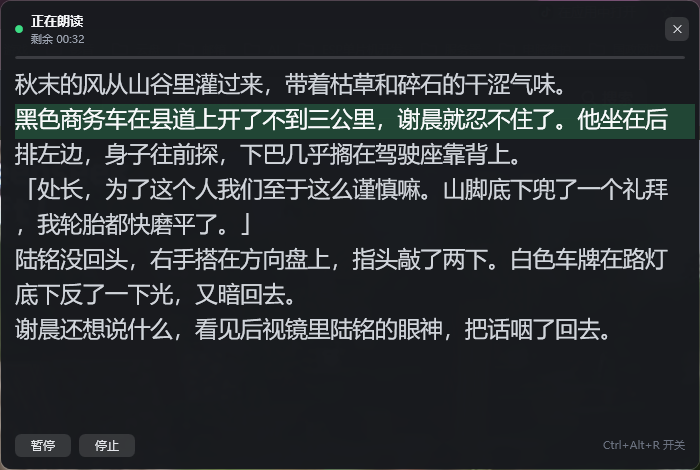
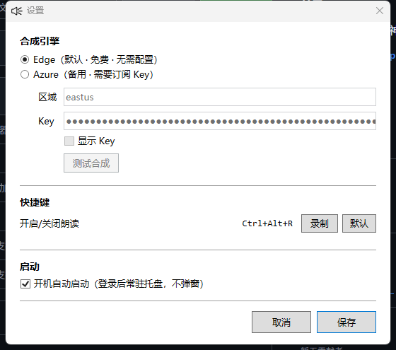

# 剪贴板朗读（SelectionTts）

Windows 10/11 托盘小工具：**复制文本，自动朗读**，并在一个常驻的「朗读板」里显示内容、合成进度和当前读到哪一行。

基于 Edge「大声朗读」同一个在线语音引擎（免费、无需 API Key），支持配置 Azure 语音作为备用引擎。

> 🧪 **早期测试版**：功能和交互还会变。
> 遇到问题、觉得哪里别扭、想要什么功能，都欢迎到 [Issues](https://github.com/yuyscfgdtg/SelectionTts/issues) 说一声。
> 反馈时附上 `data\logs\app.log` 里相关的几行最好（日志只记字数，不记录复制的内容）。



## 特性

- **复制即读**：监听系统剪贴板，`Ctrl+C` 后自动朗读；新内容立即打断旧内容
- **朗读板**：无焦点浮窗，按板子宽度逐行排版，读到哪行哪行高亮，**点任意一行就从那一行的句子开始读**
- **句级缓存**：一句话一个音频块，跳回已合成的位置 2–5ms 出声，不重新合成
- **合成进度条**：始终以全文为分母，跳转不重置；合成完自动收起
- **总开关**：托盘图标灰度 + `Ctrl+Alt+R` + 板子按钮，关掉即停止并清空缓存
- **暂停 / 继续**：只作用于当前这一段
- **备用引擎**：Azure 语音（手动切换，Key 用 Windows DPAPI 加密）
- **可配置热键**：默认 `Ctrl+Alt+R`，冲突时自动回滚
- **开机自启**：设置里勾选，写的是启动文件夹快捷方式（可在任务管理器里看到）
- 日志只记字数，不记录复制内容

## 安装

从 [Releases](../../releases) 下载 `SelectionTts-Setup-x.y.z.exe`，双击安装：

- **不需要管理员权限**，默认装到 `%LOCALAPPDATA%\Programs\SelectionTts`
- 安装时可勾选「开机自动启动」「桌面快捷方式」
- 卸载在「设置 → 应用」或运行安装目录的 `unins000.exe`
- **卸载会保留 `data\`（设置和日志）**，卸载提示里可确认是否删除
- 覆盖安装即升级，配置保留

> 程序没有数字签名，首次运行 Windows SmartScreen 会提示，点「更多信息 → 仍要运行」即可。

也可以直接用免安装版：`publish\win-x64\SelectionTts.exe`（单文件，设置和日志写在 exe 旁的 `data\`）。

## 使用

1. 启动后托盘出现图标，默认**灰色 = 已关闭**
2. 按 `Ctrl+Alt+R` 或托盘菜单首项启用（图标变彩色）
3. 在任意程序里复制文本，朗读板立刻显示内容并开始朗读

| 操作 | 效果 |
|---|---|
| `Ctrl+Alt+R` | 开/关朗读（软件总开关） |
| 板子上 `暂停` / `继续` | 临时停止当前这段 |
| 板子上 `停止` / `启动` | 等同于总开关 |
| 点板子上某一行 | 从该行所在句子开始读 |
| 托盘 → 设置… | 引擎、Azure Key、热键、开机自启 |
| 托盘 → 显示朗读板 | 重新打开被 `×` 隐藏的板子 |



## 朗读板的行为

```
正在合成 54%            ← 进度条只表示合成到哪了，合成完自动收起
已合成 2100/5000 字

第一行……                ← 正在读的这一行整行高亮（高亮就是播放进度）
第二行……
```

- 正文按板子宽度自动折行，**一行就是一个可点的单元格**
- 点某一行 → 引擎落到**这一行所在句子的开头**（行可能只是半句，没有音频时间戳时这是最精确的位置）
- 跳到**已合成**的位置：直接播缓存，零等待
- 跳到**未合成**的位置：合成立刻跳到那一句、边合成边读
- 读到结尾就算读完；中间跳过的句子会在后台静默补齐（不出声），进度条补到 100%
- 复制新文本 / 关总开关：旧文本和全部音频缓存立即丢弃

## 隐私

- 文本是发送到**微软的在线语音服务**（Edge 或 Azure）合成的，这一点无法避免
- 朗读板是**内存里的临时缓存**：换文本或关总开关即释放，不落盘
- 日志只记录字数、耗时、状态，不记录任何复制内容
- Azure Key 用 Windows DPAPI 加密后存进配置，只对当前用户可解密

## 已知限制

- 依赖网络；断网无法朗读
- 单次最长 5000 字，超出截断
- 合成单位是「一句话」：请求数比整段合成多（5000 字约 100+ 次），首次把缓存填满约需 1 分钟——播放本身要十几分钟，所以合成始终跑在播放前面
- Azure 免费层有每分钟请求数限制，撞到 429 会等待重试，表现为进度条暂时停住
- Edge 接口的令牌算法会随版本变化，升级时需同步 `Tts/DrmToken.cs`

## 构建

需要 .NET SDK 10 与 [Inno Setup 6](https://jrsoftware.org/isinfo.php)（仅打包安装包时需要）。

```powershell
cd app\SelectionTts

# 单文件版
dotnet publish -c Release -r win-x64 --self-contained true -p:PublishSingleFile=true `
  -p:IncludeNativeLibrariesForSelfExtract=true -p:EnableCompressionInSingleFile=true `
  -o publish\win-x64

# 安装包
& "$env:LOCALAPPDATA\Programs\Inno Setup 6\ISCC.exe" installer\SelectionTts.iss
```

产物：

- `publish\win-x64\SelectionTts.exe` — 单文件，目标机不需要装 .NET
- `installer\output\SelectionTts-Setup-x.y.z.exe` — 一键安装包

## 目录结构

```
app/SelectionTts/
  App.xaml.cs            启动、托盘与热键接线
  Core/
    ReaderService.cs     朗读编排：句级缓存、seek、合成调度
    TextSegmenter.cs     按句切分
    Settings.cs          配置读写
  Tts/
    EdgeTtsClient.cs     Edge 接口（WebSocket，带词时间戳）
    AzureTtsClient.cs    Azure 接口（REST，备用）
  Audio/StreamingAudioPlayer.cs   PCM 缓冲连续播放
  Ui/ReaderBoardWindow.xaml      朗读板
  Ui/SettingsWindow.xaml         设置
  Platform/                      剪贴板、热键、DPAPI、自启
  installer/SelectionTts.iss     安装包脚本
docs/
  d2-report.md … d7-report.md     早期原型阶段的验证报告
  images/                        截图
```

## 关于 Phase 0

最初的形态是「划词朗读」：选中文字后弹按钮朗读。Phase 0 用 Python + PySide6 验证了取词、Edge TTS 延迟、弹窗交互和打断行为（见 `docs/d2`–`d7`），结论是可行但交互打扰太大，最终改为现在的**剪贴板朗读 + 朗读板**形态，并用 C# 重写。

原型代码已删除，验证结论保留在文档里。

## 许可证

[MIT](LICENSE)
